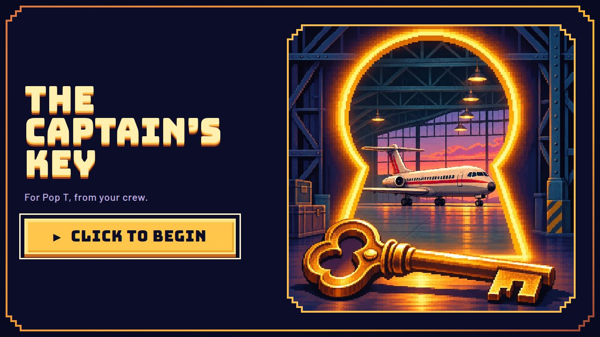
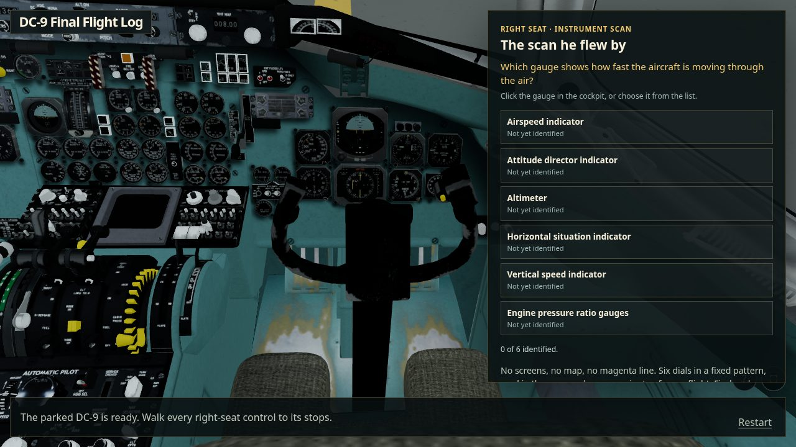
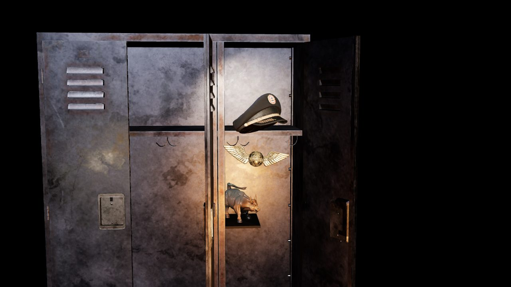
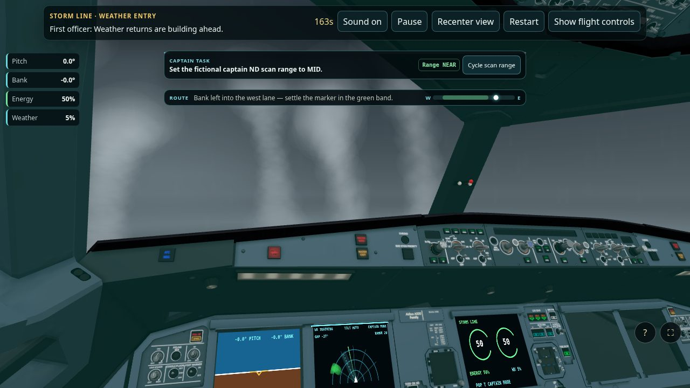
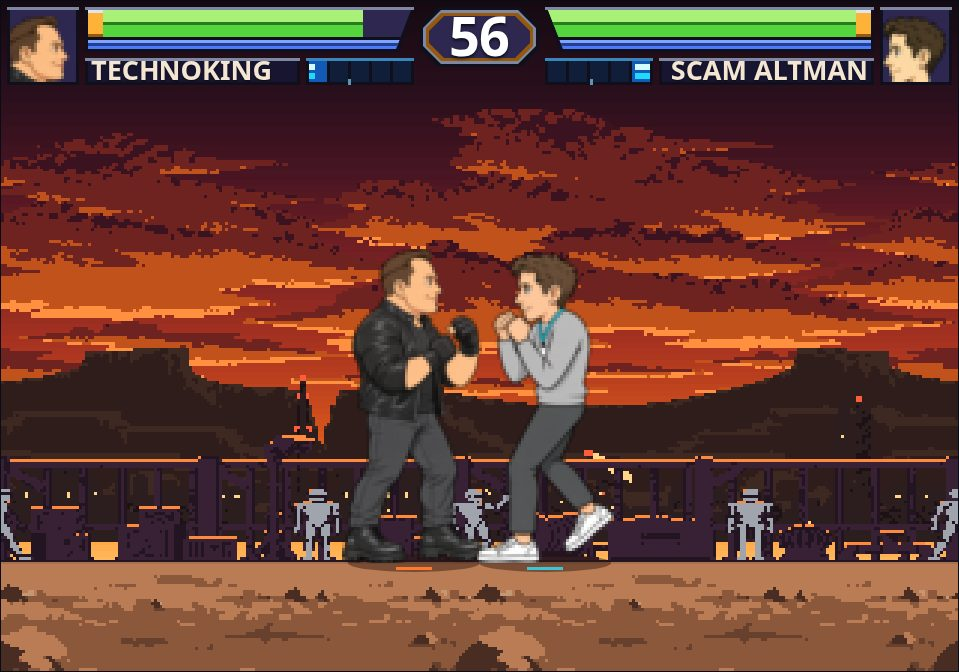

# CockpitEscapeRoom

**The Captain's Key** is a 3D browser game made for a pilot dad. It follows his career from the right seat of a McDonnell Douglas DC-9 to the left seat of an Airbus A320, with family memories along the way.



## The journey

1. **Intro**: a console-era cinematic, then *Press Start*.
2. **DC-9 Final Flight Log**: check the right-seat controls, scan the instruments, fly a fictional 1995 Memphis departure and secure the parked aircraft.
3. **The Captain's Locker**: answer four memories to reveal the captain's hat.
4. **Airbus A320 Pop T Captain Mode**: qualify, then fly Storm Line and Engine-Out Handling.
5. **A surprise reward** to finish.

| | |
| --- | --- |
|  |  |
|  |  |

It plays on phones too, with touch controls. On iPhone, add it to your Home Screen for full screen.

## Hidden arcade

After finishing the game once, hold **T+M+B** for 1.5 seconds, or press and hold the final title for 3 seconds on a phone, to open a Mars fighting game.

## Run locally

Requires Node.js 24.

```bash
npm install
npm run dev
```

## Checks

```bash
npm run check       # lint, types, unit tests and build
npm run test:e2e    # browser tests
```

## More

[Blueprint](BLUEPRINT.md) · [Game design](docs/GAME_DESIGN.md) · [Architecture](docs/ARCHITECTURE.md) · [Asset pipeline](docs/ASSET_PIPELINE.md) · [Contributor guide](AGENTS.md) · [Test report](TEST_REPORT.md)
